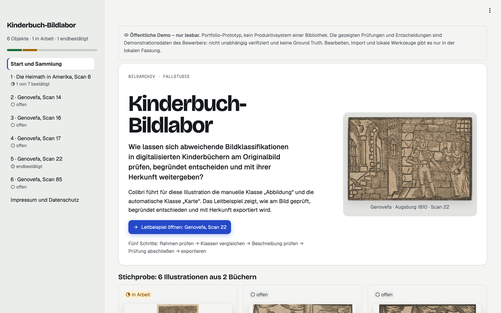
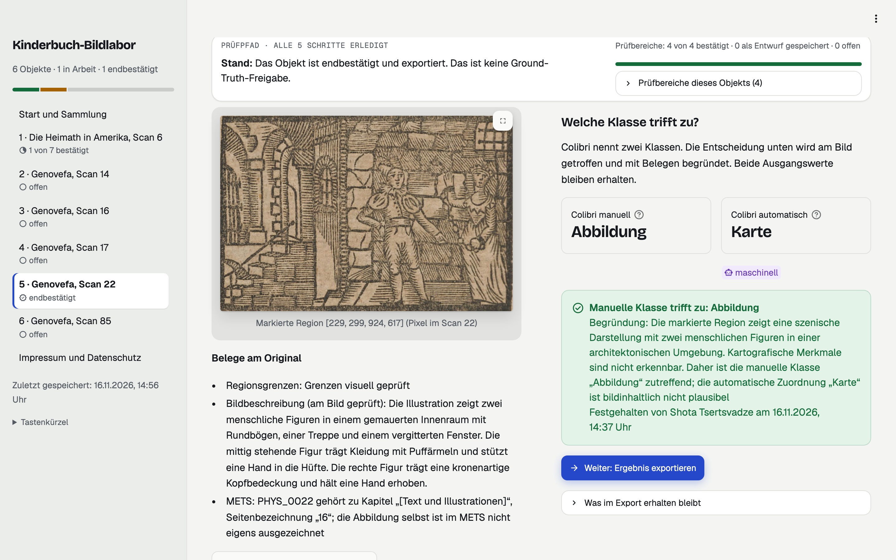
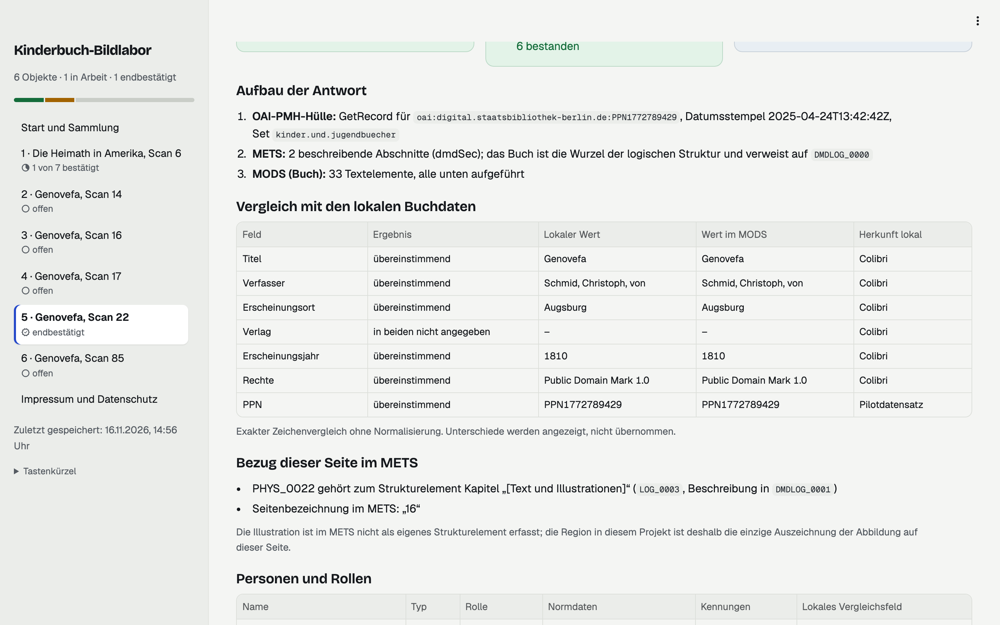
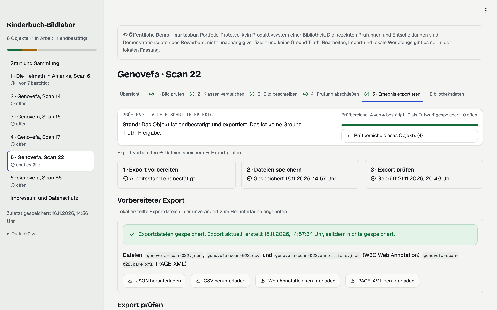

# Kinderbuch-Bildlabor

**Portfolio-Prototyp zur Datenqualität in digitalisierten historischen Kinderbüchern.** Konzeption,
fachliche Anforderungen und alle Prüfentscheidungen stammen von mir; die Software wurde mit
Unterstützung eines KI-Programmierassistenten umgesetzt. Grundlage sind öffentlich zugängliche Daten der
Staatsbibliothek zu Berlin (Colibri-Datensatz, METS/MODS über OAI-PMH, IIIF-Scans). Kein
Produktivsystem einer Bibliothek.

> **Die Frage:** Wie lassen sich abweichende Bildklassifikationen am Originalbild prüfen, begründet
> entscheiden und mit ihrer Herkunft weitergeben?

## Fallstudie: „Genovefa“ (Augsburg 1810), Scan 22

| | Colibri manuell | Colibri automatisch | Meine Entscheidung |
|---|---|---|---|
| Klasse der Illustration | **Abbildung** | **Karte** | **Abbildung**, begründet am Originalbild |

1. **Das Problem.** Für dieselbe Illustration nennt der Colibri-Datensatz zwei verschiedene Klassen.
   Keiner der beiden Werte ist allein verlässlich; entscheiden lässt sich nur am Original.
2. **Prüfung am Bild.** Bildregion am Scan geprüft und bestätigt. Befund: eine szenische Darstellung mit
   zwei Figuren in einem gemauerten Innenraum, keine kartografischen Merkmale.
3. **Prüfung der Metadaten.** Die Anwendung stellt Titel, Verfasser, Ort und Jahr aus Colibri dem
   METS/MODS-Datensatz der Staatsbibliothek gegenüber, exakt und ohne Normalisierung. Für die
   Illustratorfrage habe ich die Buch-MODS geprüft: Christoph von Schmid ist als Verfasser („aut“)
   erfasst, ein Illustrator nicht. Das Feld bleibt deshalb begründet leer.
4. **Dokumentation.** Jede Bestätigung und Entscheidung trägt Begründung, Name und Zeitpunkt; beide
   Ausgangswerte bleiben erhalten; spätere Änderungen heben Bestätigungen auf. Die Endbestätigung ist
   ausdrücklich die Prüfung einer Person, nicht unabhängig verifiziert und keine Ground Truth.
5. **Ergebnis.** Export als JSON, CSV, W3C Web Annotation und PAGE-XML sowie ein Prüfbericht als HTML,
   jeweils mit Herkunftsangaben; eine Rückladeprüfung vergleicht den gespeicherten JSON-Export mit dem
   Arbeitsstand. Der geprüfte Stand liegt unverändert unter [`demo/`](demo/).

## So sieht es aus

<table>
<tr>
<td width="50%"><br><sub><b>1 · Einstieg:</b> Fragestellung, Klassenkonflikt und direkter Weg zur Fallstudie.</sub></td>
<td width="50%"><br><sub><b>2 · Klassen vergleichen:</b> manuell „Abbildung“, automatisch „Karte“; Entscheidung mit Begründung, Name und Zeitpunkt.</sub></td>
</tr>
<tr>
<td width="50%"><br><sub><b>3 · METS/MODS:</b> OAI-PMH-Antwort, exakter Feldvergleich mit dem MODS, Seitenbezug im METS.</sub></td>
<td width="50%"><br><sub><b>4 · Ergebnis:</b> endbestätigt, Export geprüft; Downloads in vier Formaten.</sub></td>
</tr>
</table>

Aufnahmen der lokal laufenden Anwendung in der nur lesbaren Ansicht (`BILDLABOR_DEMO=1`), unverändert.
Rundgang zum Nachklicken: [RUNDGANG_DEMO.md](docs/RUNDGANG_DEMO.md) ·
[Projektüberblick](docs/PROJEKTUEBERSICHT.md)

## Woran ich gearbeitet habe

Ich komme aus dem Prozessmanagement und bilde mich beruflich im Bereich Digitalisierung weiter. Das
Bildlabor ist eigene Lern- und Portfolioarbeit, keine Tätigkeit in oder für eine Bibliothek. Fachlich
beschäftigt haben mich dabei:

- **Metadaten lesen und abgleichen:** OAI-PMH-Antworten, METS-Struktur (logische Wurzel, Seitenbezug,
  `DMDID`) und MODS-Felder mit Rollen; Abgleich mit Colibri, ohne Unterschiede wegzunormalisieren.
- **Datenqualität als Ablauf:** ein Prüfpfad mit getrennten Bestätigungen je Bereich, begründete
  Entscheidungen statt ausgeblendeter Hinweise; „nicht entscheidbar“ ist zulässig und lässt den
  Hinweis offen.
- **Provenienz:** wer was wann und warum bestätigt hat, bleibt im Datensatz und in jedem Export erhalten.
- **Austauschformate:** W3C Web Annotation und PAGE-XML neben JSON und CSV, mit Prüfung des Exports.

**Meine Arbeit und KI-Unterstützung.** Fragestellung, fachliche Anforderungen, Auswahl der Quellen und
alle Prüfentscheidungen der Fallstudie stammen von mir; die Entscheidungen habe ich selbst in der
Anwendung getroffen. Ein
KI-Programmierassistent (Claude) hat Anwendung, Tests und Dokumentationsentwürfe nach meinen Vorgaben
umgesetzt. Die Bildbeschreibung und die Suchbegriffe sind Entwürfe des KI-Assistenten; sie sind im
Datensatz so gekennzeichnet und gelten erst durch meine Bestätigung mit Name und Zeitpunkt als geprüft.

**Grenzen.** Eine geprüfte Fallstudie; die übrigen fünf Beispiele stehen bewusst im ungeprüften
Quellstand. Keine Zweitprüfung durch eine andere Person, keine XSD-Validierung, kein vollständiges
Harvesting.

**Rechte.** Digitalisate Public Domain Mark 1.0; Colibri-Klassen CC BY 4.0; die beschreibenden
METS/MODS-Metadaten veröffentlicht die Staatsbibliothek zu Berlin unter CC BY 4.0 (Abgrenzung zu den
vollständigen OAI-PMH-Dateien in [`rechtliches/lizenzen.md`](rechtliches/lizenzen.md)); eigene
Prüfbeiträge CC BY 4.0 (Shota Tsertsvadze). Einzelheiten: [`demo/LICENSES.md`](demo/LICENSES.md).

## Einrichtung

1. **uv installieren** (offizielle Anleitung: <https://docs.astral.sh/uv/getting-started/installation/>):
   - macOS und Linux: `curl -LsSf https://astral.sh/uv/install.sh | sh`
   - Windows (PowerShell): `powershell -ExecutionPolicy ByPass -c "irm https://astral.sh/uv/install.ps1 | iex"`
   - alternativ mit Homebrew: `brew install uv`

   Danach ein neues Terminal öffnen und mit `uv --version` prüfen.
2. **Projektordner bereitstellen:** das Repository klonen oder auf GitHub über „Code“ → „Download ZIP“
   herunterladen und entpacken (ein erhaltenes Übergabe-ZIP ebenso), dann im Terminal in den Ordner
   wechseln, zum Beispiel `cd ~/Downloads/kinderbuch-bildlabor`.
3. **Einrichten:** `uv sync --locked`. uv lädt dabei Python 3.13 und die Abhängigkeiten in genau den
   Versionen aus `uv.lock` (Streamlit 1.67.0, Pillow 13.0.0). Nur dieser Schritt braucht Internet.

## Starten

```bash
uv run streamlit run app.py
```

Der Browser öffnet <http://localhost:8501>. Die Anwendung arbeitet danach ohne Internetverbindung und
ist nur auf diesem Rechner erreichbar. Beenden mit `Strg+C` im Terminal.

Für eine eigene Prüfung, die von anderen Arbeitsständen getrennt bleibt, einen eigenen Datenordner
verwenden:

```bash
BILDLABOR_DATA_DIR=/tmp/bildlabor-probe uv run streamlit run app.py
```

(Windows PowerShell: `$env:BILDLABOR_DATA_DIR="$env:TEMP\bildlabor-probe"; uv run streamlit run app.py`)

## Nutzung

1. Auf der Startseite **„Leitbeispiel öffnen: Genovefa, Scan 22“** wählen.
2. Im Prüfpfad unter „Prüfende Person“ einen Namen eintragen. Der Prüfpfad nennt den aktuellen
   Schritt und die nächste Handlung, zählt die Prüfbereiche des Objekts (bestätigt, als Entwurf
   gespeichert, offen) und zeigt den Stand der Endbestätigung. Nach jedem Speichern führt
   **„Weiter“** zum nächsten Schritt; die Reiter bleiben zum Nachsehen erreichbar.
3. „Zweites Beispiel öffnen“ zeigt Verlagsangabe und OCR bei „Die Heimath in Amerika“.

Ein frisch gestarteter Datenordner zeigt alle sechs Beispiele im Quellstand, also ungeprüft. Der
maßgebliche geprüfte Stand der Fallstudie liegt unter [`demo/`](demo/) (Arbeitskopie, Exporte,
Herkunft in [`PROVENANCE.md`](demo/PROVENANCE.md)) und erscheint in der nur lesbaren Ansicht
(`BILDLABOR_DEMO=1`). [`docs/ergebnis/`](docs/ergebnis/README.md) ist ein älterer Export mit frühen
Testeinträgen und nicht maßgeblich. Begriffe wie *Endbestätigung* und *Ground Truth* erklärt
[docs/BEGRIFFE.md](docs/BEGRIFFE.md).

## Eigene Bücher und lokale OCR

- **Import:** Startseite → „Eigenes Buch importieren“: JPEG/PNG, PDF oder öffentliche IIIF-Manifest-URL
  (Presentation 2/3; nur einfache Bildseiten, nur auf ausdrücklichen Knopfdruck aus dem Netz). Importierte
  Bücher liegen vollständig unter `data/imports/` und funktionieren danach offline. Unbekannte Angaben
  bleiben unbekannt; OAI/METS-, IIIF-Bildinfo- und Colibri-Prüfungen erscheinen als „nicht ausgeführt“.
- **Angaben:** Reiter „Angaben“ (nur importierte Bücher): Verfasser, Ort, Jahr, Verlag, Rechte, Quelle,
  Seitenzahl und Illustrator eintragen und gesondert bestätigen. Das CSV hat dafür eigene Spalten
  (`verfasser`, `erscheinungsort`, `erscheinungsjahr`, `verlag`, `bibliografie_pruefstatus`); ältere
  CSV-Exporte haben diese Spalten nicht.
- **PDF** braucht lokal Poppler (`pdfinfo`, `pdftoppm`; macOS: `brew install poppler`).
- **Regionen zeichnen:** Reiter „Regionen“ → Rahmen auf dem Scan ziehen, verschieben, mit Umschalt mehrere
  wählen; Pfeiltasten und Zahlenfelder sind gleichwertige Alternativen. Gespeichert wird erst ausdrücklich.
  Mausrad oder +/- zoomt, Ziehen oder Leertaste+Ziehen verschiebt, 0 zeigt die Gesamtansicht; die Regler für
  Helligkeit und Kontrast ändern nur die Anzeige. Taste n springt zum nächsten offenen Reiter, b fokussiert
  die Bestätigung, ? liest die Hilfe vor; Tasten bestätigen nie etwas.
- **Zurückziehen:** Bei importierten Büchern lässt sich eine Region im Reiter „Regionen“ mit Grund
  zurückziehen; bei jedem Objekt eine begründete Entscheidung. Der Inhalt bleibt mit Person, Zeit und
  Grund im JSON-Export (`withdrawn_regions`, `withdrawn_decisions`) und im Prüfprotokoll.
- **Zweite Lesung:** Textregionen können mit lokalem Tesseract (`brew install tesseract`, Modelle nach
  Bedarf; optional `BILDLABOR_TESSERACT`, `BILDLABOR_TESSDATA`) erneut gelesen werden. Das Ergebnis
  ist ein Vergleichstext, keine Bewertung; ohne Tesseract bleibt die manuelle Transkription nutzbar.

**Schriften:** Bricolage Grotesque, Geist und Geist Mono liegen lokal unter `static/fonts/` (SIL OFL), die Anwendung lädt nichts aus dem Netz.

**Daten:** Quelldateien in `Kinderbuch_Bildlabor_Start/` und `sammlung/` werden nie verändert.
Arbeitsstände (`data/work/`) und Exporte (`exports/`) entstehen erst beim Speichern, mit
`BILDLABOR_DATA_DIR` im angegebenen Ordner. Vor jedem Überschreiben bleibt der bisherige Stand unter
`data/work/.history/` erhalten; das ersetzt keine Sicherung auf einem anderen Gerät. Zurück zum
Quellstand: Server stoppen, die Arbeitsdatei in einen Archivordner verschieben (nicht löschen), neu
starten.

**Sicherung:** Die Startseite bietet ein Sicherungspaket (ZIP mit Prüfsummen; Arbeitsstände,
Importe, Exporte) zum Herunterladen und prüft hochgeladene Pakete. Das Paket enthält Prüfarbeit
und Namen: nicht ins Git, nicht öffentlich teilen. Kommandozeile:

```
uv run python -m kinderbuch_bildlabor.backup create PAKET.zip
uv run python -m kinderbuch_bildlabor.backup verify PAKET.zip
uv run python -m kinderbuch_bildlabor.backup restore PAKET.zip NEUER_ORDNER
BILDLABOR_DATA_DIR=NEUER_ORDNER uv run streamlit run app.py
```

Zurückspielen schreibt nur in einen neuen oder leeren Ordner und nur nach bestandener Prüfung;
bestehende Daten werden nie überschrieben.

## Qualitätsprüfungen

```bash
uv run --locked ruff check --no-cache .
uv run --locked ruff format --check --no-cache .
uv run --locked mypy
uv run --locked python -B -m pytest -p no:cacheprovider -q
```

Die Befehle gelten für macOS, Linux und Windows. mypy legt seinen Zwischenspeicher in `.mypy_cache/`
ab; den Ordner markiert mypy selbst als von Git ignoriert, er kann jederzeit gelöscht werden. Die
Tests arbeiten in temporären Ordnern und berühren `data/work/` und `exports/` nicht.

Optional: `BILDLABOR_OLLAMA_MODEL` wählt das lokale Modell für Vorschläge (Standard `qwen2.5vl`; die Funktion erscheint nur, wenn Ollama auf localhost läuft).

## Öffentliche Demo (nur lesbar)

`BILDLABOR_DEMO=1 uv run streamlit run app.py` zeigt den kuratierten Stand aus `demo/`, ohne Bearbeiten,
Import, Netzabrufe oder externe Programme. Anlegen des Stands: [DEMO_KURATIERUNG.md](docs/DEMO_KURATIERUNG.md).
Pflichtangaben und Lizenzangaben für den öffentlichen Betrieb stehen in `rechtliches/`, Rechte am
Demonstrationsstand in `demo/LICENSES.md`; Container und Server:
[BETRIEB.md](docs/BETRIEB.md).

## Weitere Dokumente

[Datensatz und Auswahl](docs/DATENSATZ.md) · [Offene Punkte](docs/OFFENE_PUNKTE.md) ·
[Architekturentscheidungen](docs/adr/) · [Abnahmebericht](docs/ABNAHME_2026-11-07.md) ·
[Bezug zur Stelle](docs/BEZUG_ZUR_STELLE.md) ·
[Gestaltung](docs/design/DESIGN_SYSTEM.md)
