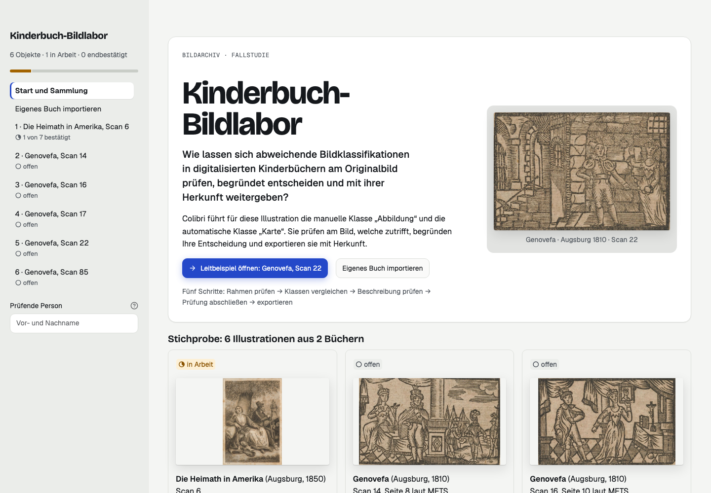
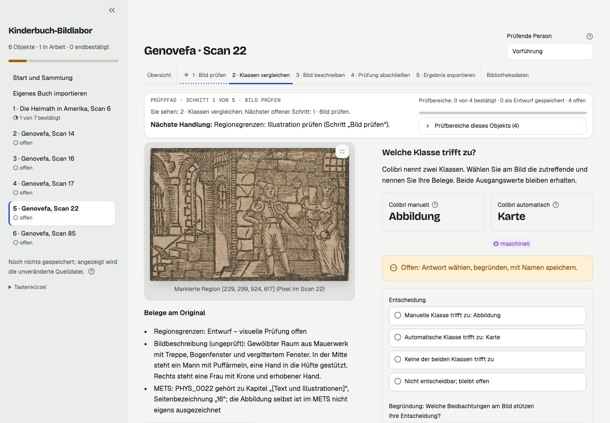
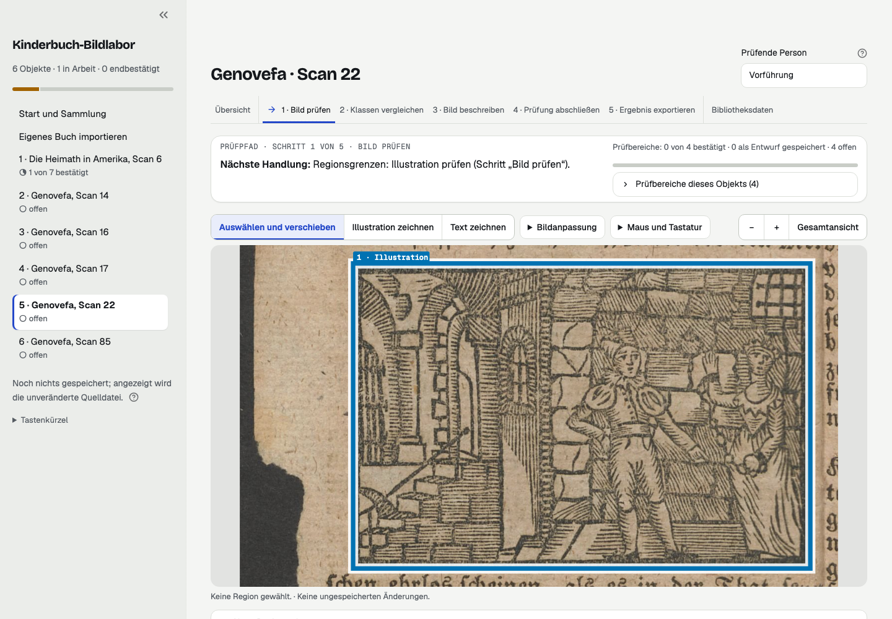
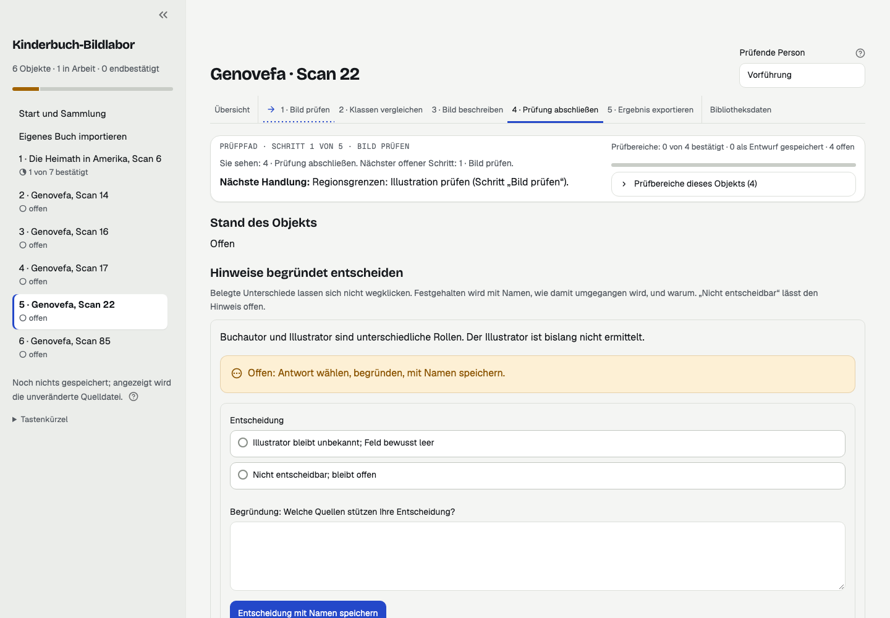
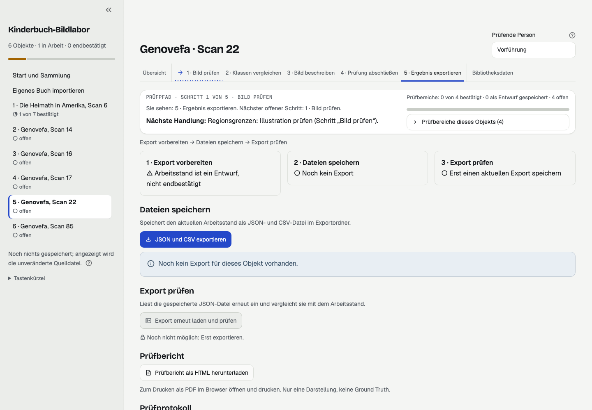
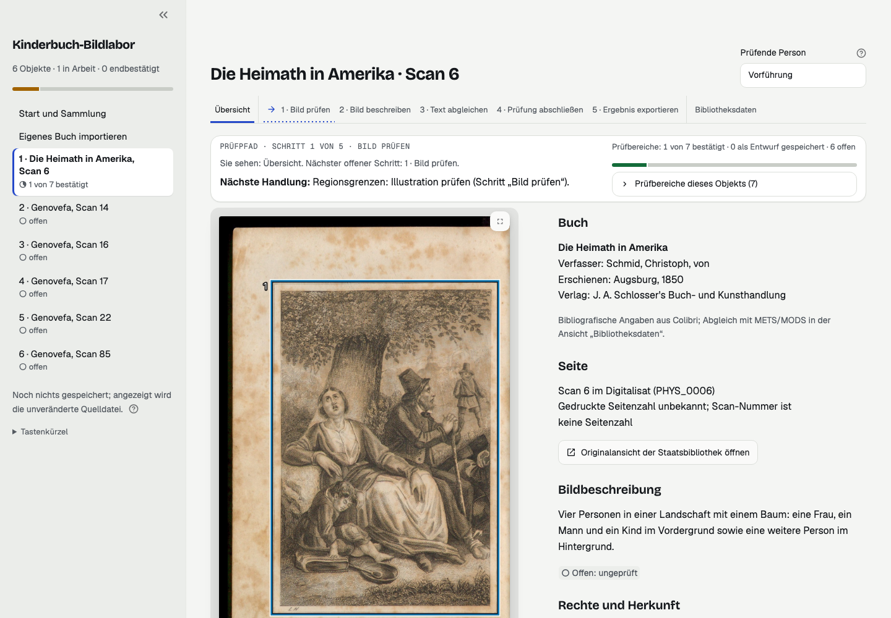
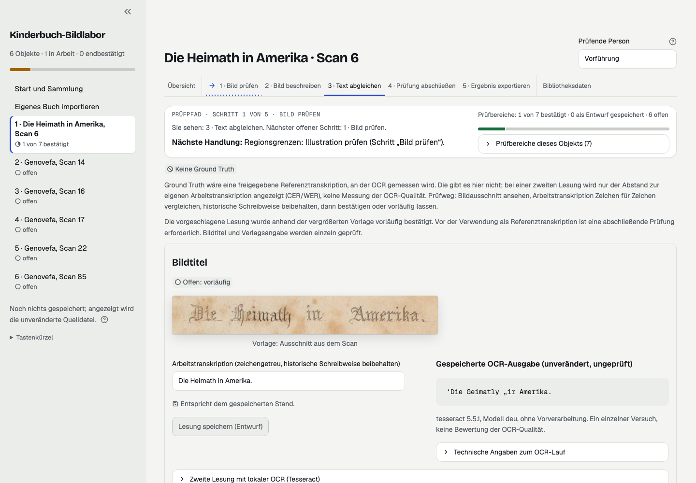

# Rundgang in drei Minuten

Vorbereitung: `BILDLABOR_DATA_DIR=/tmp/vorfuehrung uv run streamlit run app.py`, Browserfenster ab etwa
1280 Pixel breit. Mit einem frischen Datenordner beginnt jedes Objekt im Quellstand. Die
Bildschirmfotos zeigen diesen Stand: Entscheidungen sind noch offen. Ein abgeschlossenes Beispiel
liegt unter [ergebnis/](ergebnis/README.md) und erscheint auf der Startseite.

## 0:00 – Startseite: die Frage (30 Sekunden)

- Leitfrage neben der Illustration vorlesen. Colibri führt eine automatische und, wo vorhanden,
  eine manuelle Klasse.
- Kasten „Abgeschlossenes Beispiel“: meine Entscheidung zu Scan 22 aus dem unveränderten Export,
  mit Download von JSON, CSV und Erläuterung. Die Begründungen stehen wörtlich darin.
- Tabelle der Fallstudie: fünf Abbildungen aus „Genovefa“, manuell jeweils „Abbildung“, automatisch
  „Druckermarke“, „Exlibris“ oder „Karte“. Auswahlkriterium nennen: alle Zeilen dieses Buches mit
  manueller Klasse. Keine Aussage über Colibri insgesamt.
- „Leitbeispiel öffnen“, dann rechts neben dem Titel unter „Prüfende Person“ einen Namen eintragen.
  Die Leiste darunter ist die einzige Navigation: Übersicht, die nummerierten Schritte und
  Bibliotheksdaten; erledigte Schritte sind abgehakt, der nächste offene ist blau mit Pfeil. Die
  Karte darunter nennt die nächste Handlung, zählt die Prüfbereiche (bestätigt, als Entwurf
  gespeichert, offen) und davon getrennt die Endbestätigung. Nach jedem Speichern führt „Weiter“
  zum nächsten Schritt.

## 0:30 – Leitbeispiel Scan 22, Schritt „Klassen vergleichen“ (60 Sekunden)

- In der Leiste „2 · Klassen vergleichen“ wählen.
- Links das Material: Ausschnitt der markierten Region, Belege (Prüfstand der Region,
  Bildbeschreibung, Seitenbezug im METS: Kapitel „[Text und Illustrationen]“, Seite 16, Link zur
  Originalansicht) und die ganze Seite. Eine gerahmte Illustration, zwei Figuren im Gewölbe.
- Rechts die Frage „Welche Klasse trifft zu?“ mit beiden Colibri-Angaben: manuell „Abbildung“,
  automatisch „Karte“. Das Fragezeichen erklärt, dass die Spalte in Colibri „groundtruth“ heißt
  und trotzdem am Bild geprüft wird.
- Darunter die Entscheidung: Auswahl und Pflichtbegründung, gespeichert mit Name und Zeitpunkt.
- „Was im Export erhalten bleibt“ aufklappen: dieselben Werte, die in der CSV stehen.

## 1:30 – Regionen und Prüfung (40 Sekunden)

- Schritt „Bild prüfen“: Auf der Zeichenfläche zeigen gestrichelte Rahmen ungespeicherte
  Änderungen. Häkchen und Bestätigung stehen neben dem Scan. Unter „Rahmen korrigieren“ den
  x-Wert per Pfeiltaste ändern, Vorschau und „Ungespeicherte Änderung“ zeigen, dann „Eingaben
  verwerfen“. „Speichern (Entwurf)“ ändert nur den Inhalt; erst „Als geprüft bestätigen“ zählt als
  geprüft. Gespeicherte Änderungen der Region heben eine Klassifikationsentscheidung auf.
- Schritt „Prüfung abschließen“: oben, was zu tun ist. Der Hinweis zum unbekannten Illustrator wird begründet
  entschieden, nicht ausgeblendet; danach ist die Endbestätigung möglich. Sie ist keine Ground
  Truth. Darunter alle Prüfergebnisse getrennt nach Art.

## 2:10 – Export (20 Sekunden)

- Drei Stufen: Export vorbereiten, Dateien speichern, Export prüfen. „JSON und CSV exportieren“
  nennt Dateien, Ordner und Zeitpunkt und bietet beide Dateien einzeln zum Herunterladen an.
  „Export erneut laden und prüfen“: alle Prüfpunkte, auch die Entscheidungen, bleiben erhalten. Die
  Prüfung gilt für diese Sitzung und genau diese Datei; die CSV wird dabei nicht zurückgelesen.

## 2:30 – Zweites Beispiel: „Die Heimath in Amerika“ (30 Sekunden)

- Übersicht: Katalog nennt Augsburg und J. A. Schlosser, das Bildblatt eine Rottweiler Buchhandlung.
  Zwei Kontexte, zwei Felder.
- Schritt „Text abgleichen“: OCR „‘Die Geimatly „ir Amerika.“ neben dem Ausschnitt und der Lesung „Die
  Heimath in Amerika.“. Ohne Referenz keine OCR-Bewertung.
