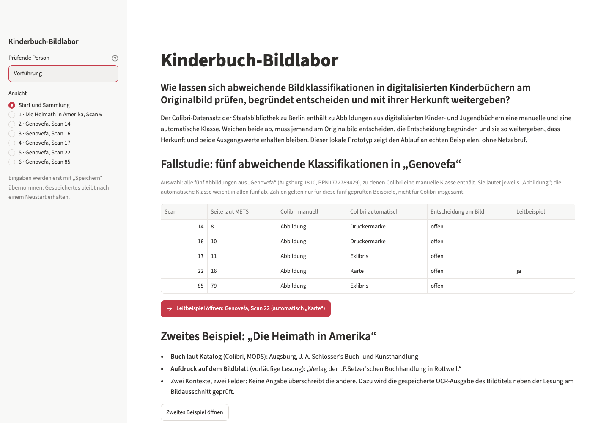
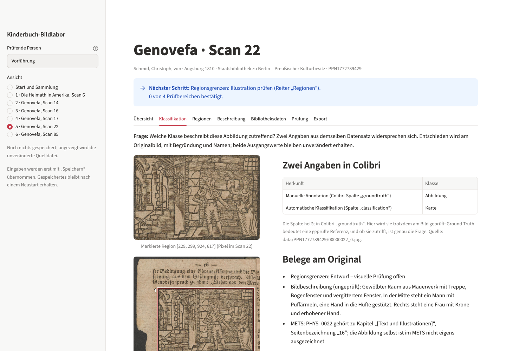
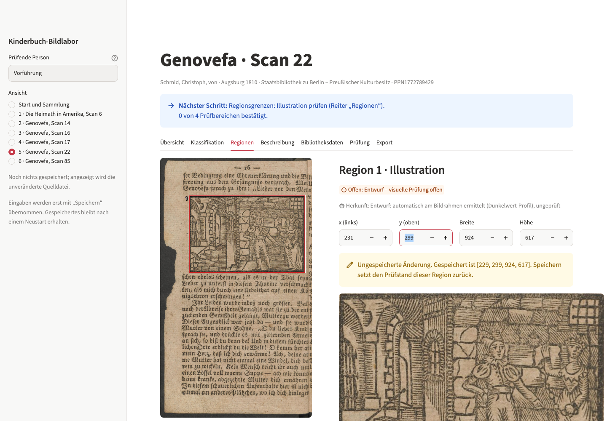
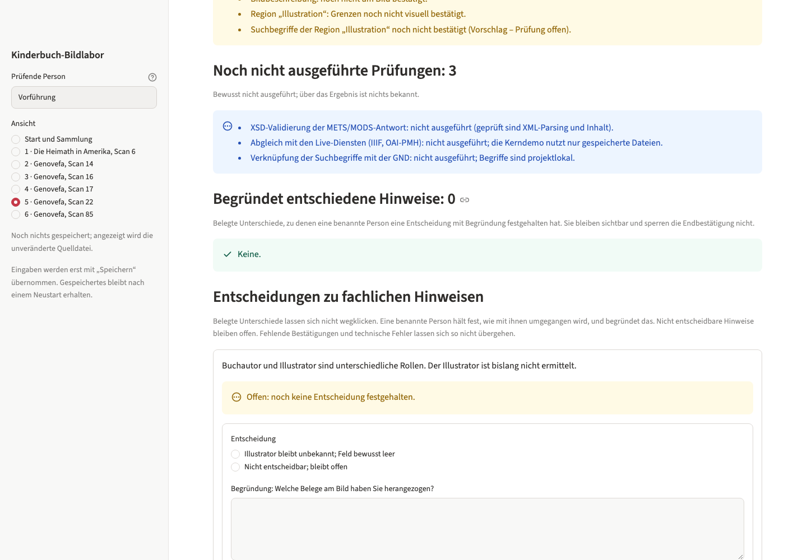
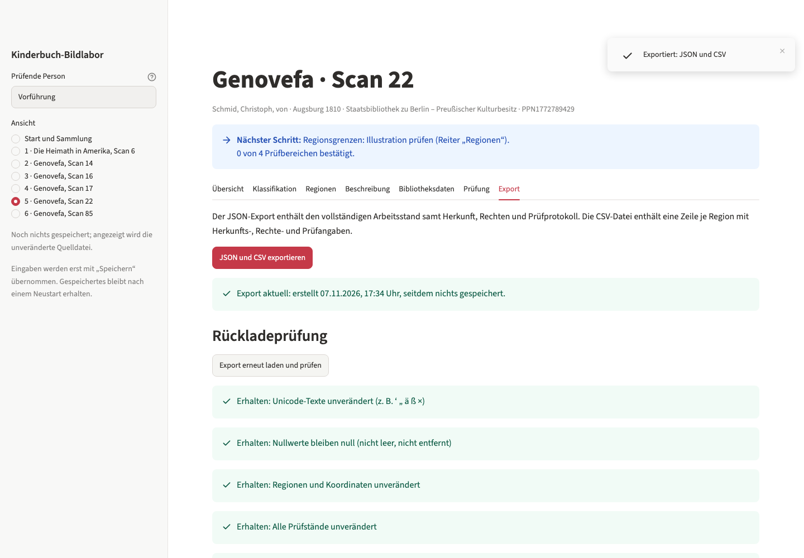
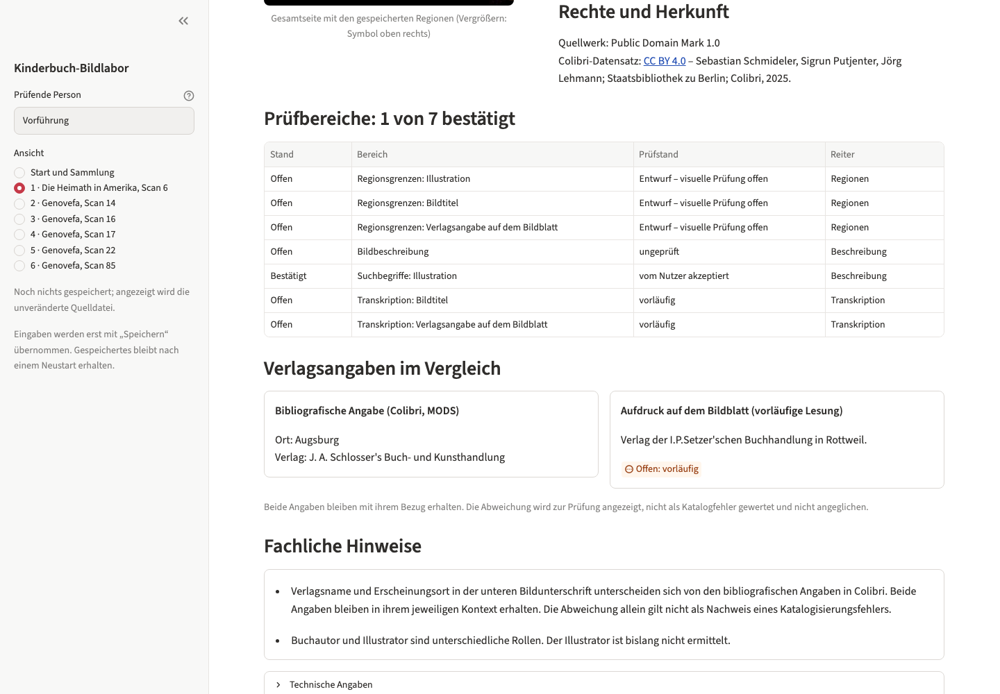
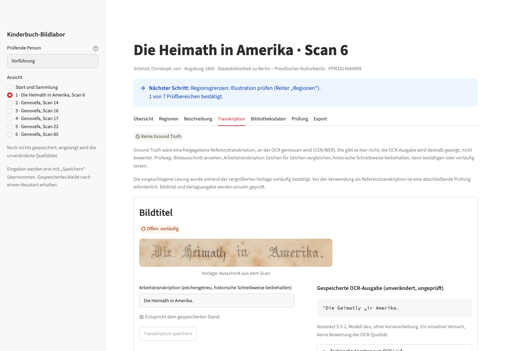

# Rundgang in drei Minuten

Vorbereitung: `BILDLABOR_DATA_DIR=/tmp/vorfuehrung uv run streamlit run app.py`, Browserfenster ab etwa
1280 Pixel breit. Der eigene Datenordner lässt die mitgelieferten Arbeitsstände unberührt. Die
Bildschirmfotos zeigen den Stand vor der menschlichen Prüfung: Entscheidungen sind noch offen.

## 0:00 – Startseite: die Frage (30 Sekunden)

- Leitfrage vorlesen. Colibri führt zu jeder Abbildung eine manuelle und eine automatische Klasse.
- Tabelle der Fallstudie: fünf Abbildungen aus „Genovefa“, manuell jeweils „Abbildung“, automatisch
  „Druckermarke“, „Exlibris“ oder „Karte“. Auswahlkriterium nennen: alle Zeilen dieses Buches mit
  manueller Klasse. Keine Aussage über Colibri insgesamt.
- Links einen Namen eintragen, dann „Leitbeispiel öffnen“.

## 0:30 – Leitbeispiel Scan 22, Reiter „Klassifikation“ (60 Sekunden)

- Links der Ausschnitt der markierten Region und die ganze Seite: ein gerahmter Holzschnitt im
  Fließtext, zwei Figuren im Gewölbe. Automatisch „Karte“.
- Rechts beide Colibri-Angaben mit Herkunft. Hinweis: Die Spalte heißt in Colibri „groundtruth“, wird
  hier aber ebenfalls am Bild geprüft.
- Belege: Prüfstand der Region, Bildbeschreibung, Seitenbezug im METS (Kapitel „[Text und
  Illustrationen]“, Seite 16), Link zur Originalansicht.
- Entscheidung: Auswahl und Pflichtbegründung, gespeichert mit Name und Zeitpunkt.
- Unten „Was im Export erhalten bleibt“: dieselben Werte, die in der CSV stehen.

## 1:30 – Regionen und Prüfung (40 Sekunden)

- Reiter „Regionen“: x-Wert per Pfeiltaste ändern, Vorschau und „Ungespeicherte Änderung“ zeigen, dann
  „Eingaben verwerfen“. Gespeicherte Änderungen der Region heben eine Klassifikationsentscheidung auf.
- Reiter „Prüfung“: technische Fehler, offene Hinweise, nicht ausgeführte Prüfungen und begründet
  entschiedene Hinweise stehen getrennt. Der Hinweis zum unbekannten Illustrator wird begründet
  entschieden, nicht ausgeblendet. Danach ist die Endbestätigung möglich; sie ist keine Ground Truth.

## 2:10 – Export (20 Sekunden)

- „JSON und CSV exportieren“, dann „Export erneut laden und prüfen“: alle Prüfpunkte, auch die
  Entscheidungen, bleiben erhalten.

## 2:30 – Zweites Beispiel: „Die Heimath in Amerika“ (30 Sekunden)

- Übersicht: Katalog nennt Augsburg und J. A. Schlosser, das Bildblatt eine Rottweiler Buchhandlung.
  Zwei Kontexte, zwei Felder.
- Reiter „Transkription“: OCR „‘Die Geimatly „ir Amerika.“ neben dem Ausschnitt und der Lesung „Die
  Heimath in Amerika.“. Ohne Referenz keine OCR-Bewertung.
