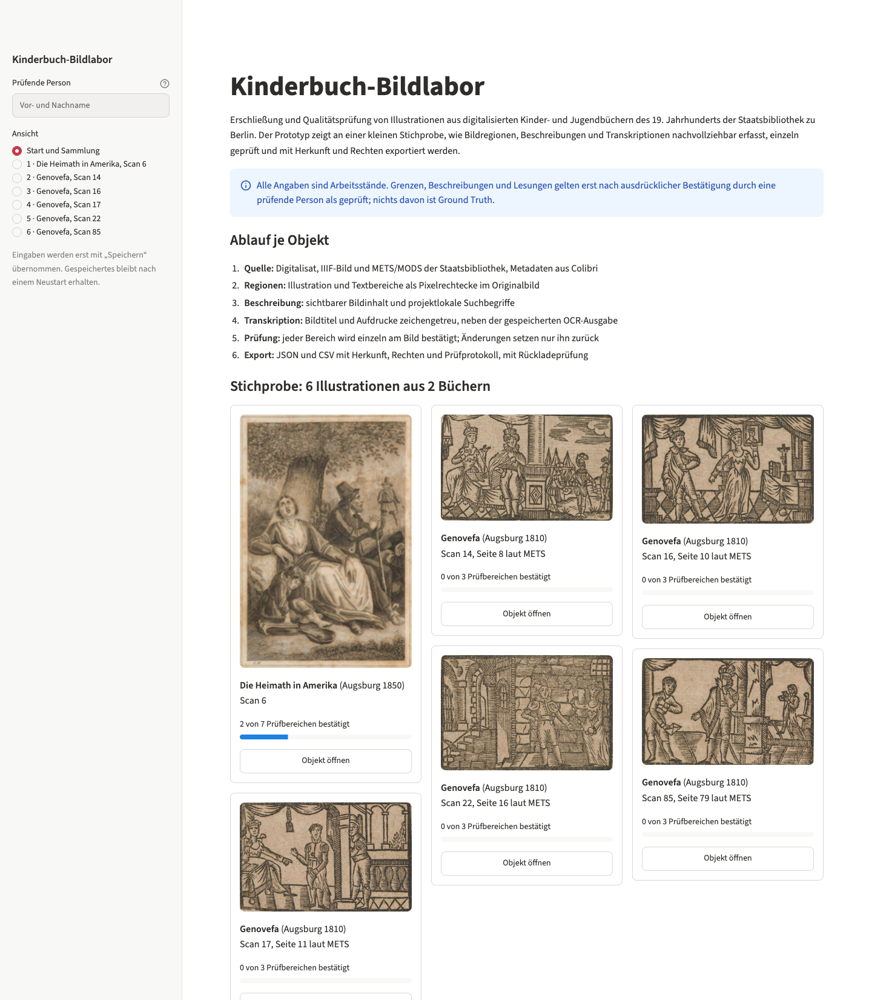
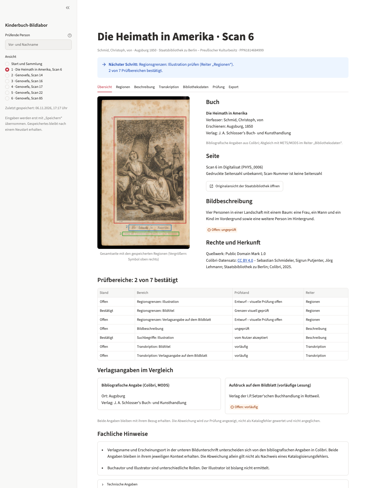
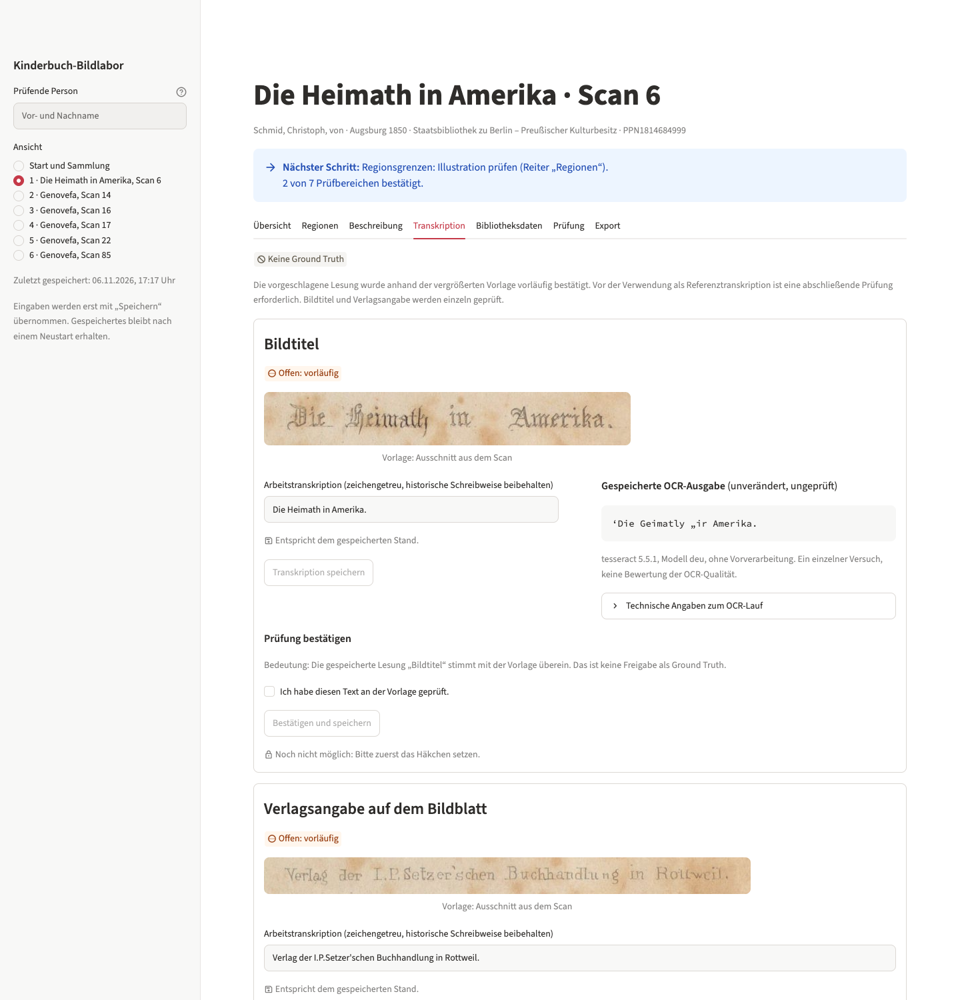
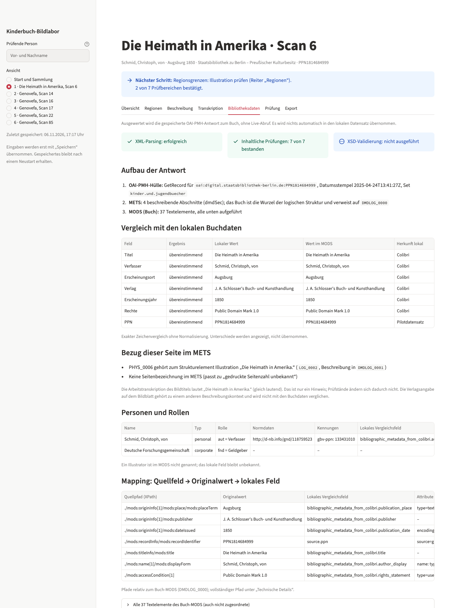
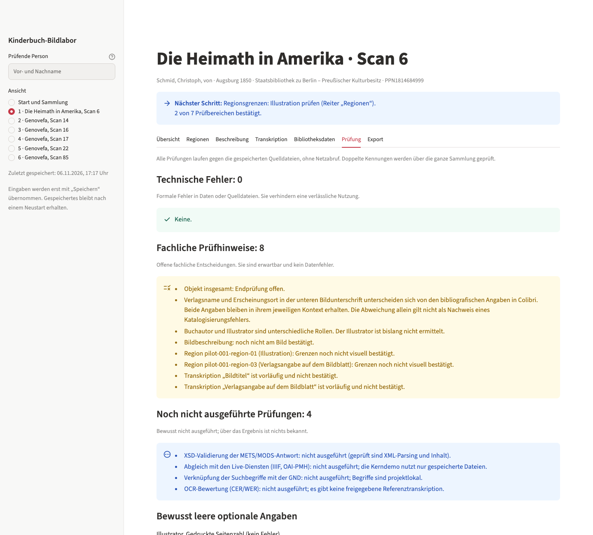
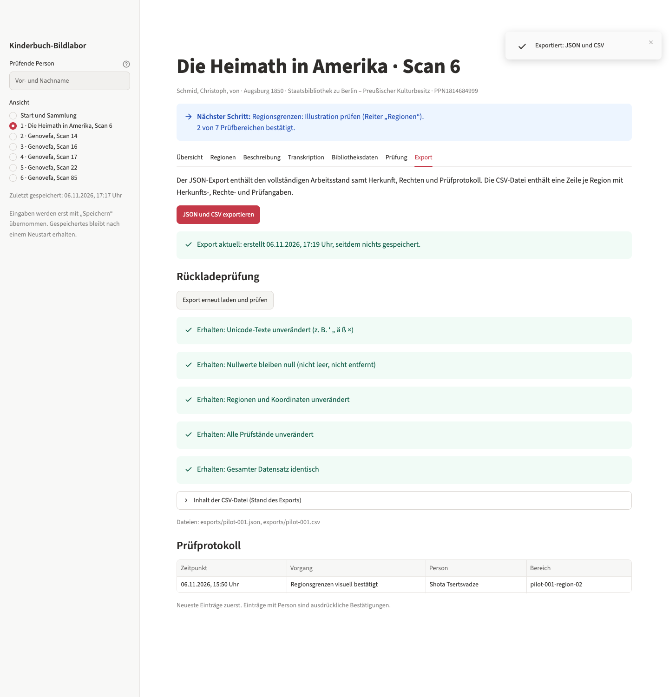
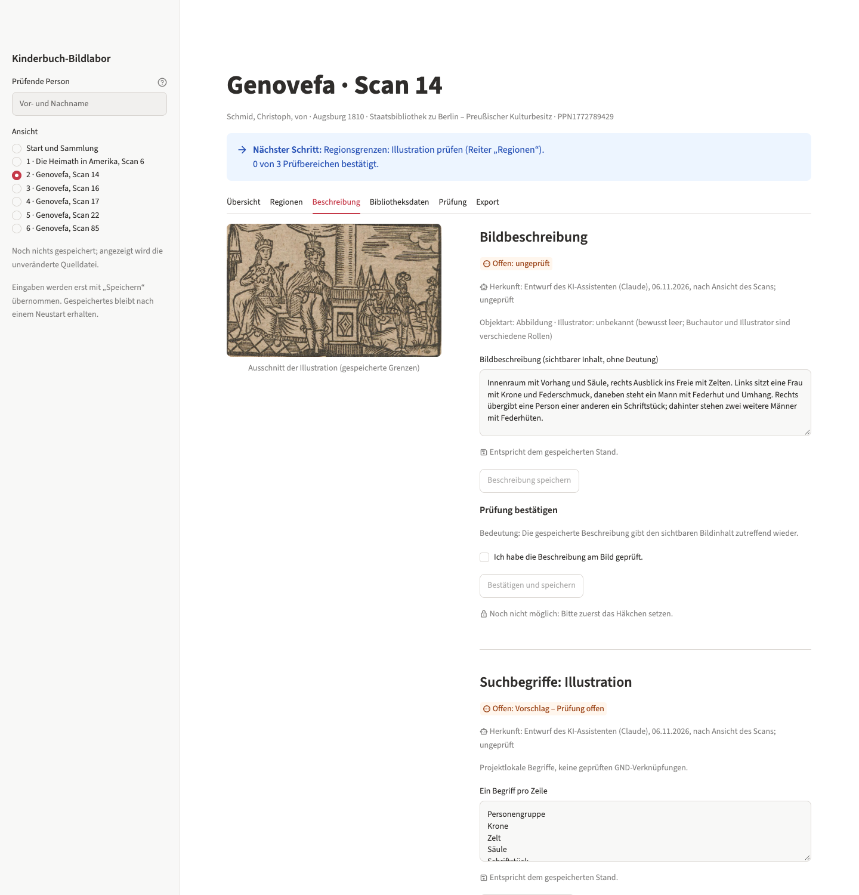

# Rundgang in drei Minuten

Vorbereitung: `uv run streamlit run app.py`, Browserfenster breit (ab etwa 1280 Pixel). Für eine
Vorführung ohne Änderung der eigenen Arbeitsstände:
`BILDLABOR_DATA_DIR=/tmp/vorfuehrung uv run streamlit run app.py`.

## 0:00 – Startseite (30 Sekunden)

- Zweck in einem Satz: Illustrationen aus Kinderbüchern der Staatsbibliothek nachvollziehbar
  erschließen, einzeln prüfen und mit Herkunft und Rechten exportieren.
- Die Stichprobe umfasst sechs echte Illustrationen aus zwei Büchern von Christoph von Schmid. Jede
  Karte zeigt, wie viele Prüfbereiche bestätigt sind.
- Den eigenen Namen links unter „Prüfende Person“ eintragen.

## 0:30 – Pilotobjekt, Übersicht (30 Sekunden)

- „Die Heimath in Amerika“, Scan 6 öffnen.
- „Nächster Schritt“ nennt den nächsten offenen Bereich.
- Verlagsangaben im Vergleich: Der Katalog nennt Augsburg, der Aufdruck auf dem Bildblatt Rottweil.
  Beide Angaben bleiben mit ihrem Bezug stehen, keine wird „korrigiert“.

## 1:00 – Regionen (40 Sekunden)

- Region „Bildtitel“ wählen und den Prüfstand zeigen. Eine eigene Arbeitskopie kann bereits eine
  Bestätigung mit Name und Zeitpunkt enthalten; im unveränderten Quellpaket ist die Region noch offen.
- Bei „Illustration“ die Breite um ein paar Pixel ändern. Es erscheinen der Hinweis „Ungespeicherte
  Änderung“ und eine Vorschau. Mit „Eingaben verwerfen“ zurücknehmen.
- Hinweis: Die Koordinaten beziehen sich auf das Originalbild, nicht auf die Anzeige.

## 1:40 – Transkription (30 Sekunden)

- Bildausschnitt, Arbeitstranskription und unveränderte OCR-Ausgabe stehen nebeneinander
  („Die Heimath“ gegenüber „Die Geimatly“).
- Titel und Verlagsangabe werden getrennt bestätigt. Es gibt keine Ground Truth und deshalb keine
  OCR-Bewertung.

## 2:10 – Bibliotheksdaten (25 Sekunden)

- Die OAI-PMH-Antwort wird geparst. Das XSD steht ausdrücklich auf „nicht ausgeführt“.
- Abgleich Colibri gegen MODS: sieben Felder übereinstimmend. Dazu der Seitenbezug im METS, Personen
  mit Rollen (Verfasser, Geldgeber) und das vollständige Mapping mit XPath.

## 2:35 – Prüfung und Export (25 Sekunden)

- Prüfung: keine technischen Fehler. Offene fachliche Hinweise und bewusst nicht ausgeführte Prüfungen
  (XSD, Live-Abgleich, GND, OCR-Bewertung) stehen getrennt.
- Endbestätigung: „Offen“, „Bereit zur Endbestätigung“ oder „Endbestätigt“ zeigen.
  Erst ohne Blocker und nach allen Einzelbestätigungen mit Name und Zustimmung bestätigen.
  Die vorhandenen fachlichen Hinweise dürfen dafür nicht übergangen werden. Inhaltsänderungen
  heben die Endbestätigung auf, nicht aber ihre Historie. Keine Ground-Truth-Freigabe.
- Export: „JSON und CSV exportieren“ und danach „Export erneut laden und prüfen“. Alle Prüfpunkte
  sind erhalten.

## Falls Zeit bleibt

- Bei „Genovefa, Scan 14“ ist die Herkunft „Entwurf des KI-Assistenten“ an Beschreibung und
  Suchbegriffen sichtbar. Ein Vorschlag wird erst durch eine Bestätigung zur geprüften Angabe.
