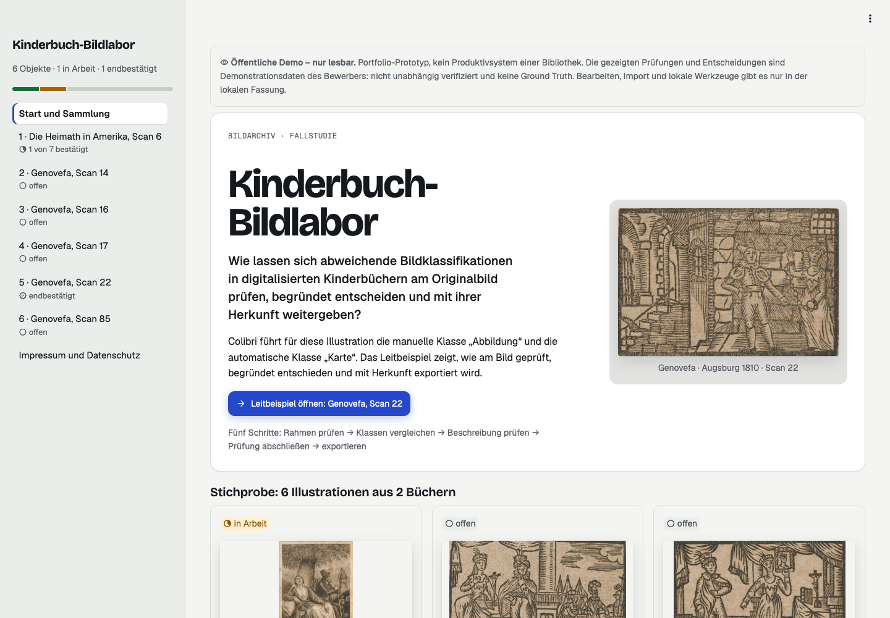
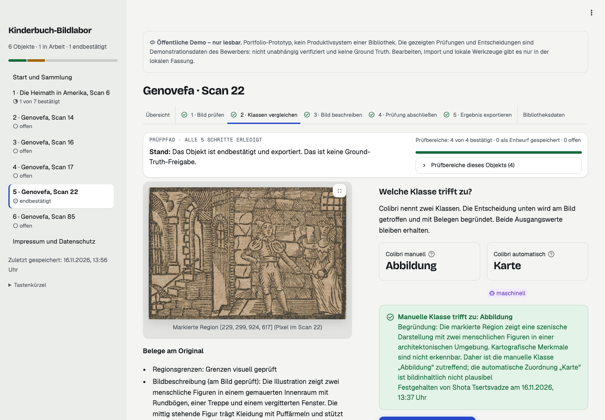
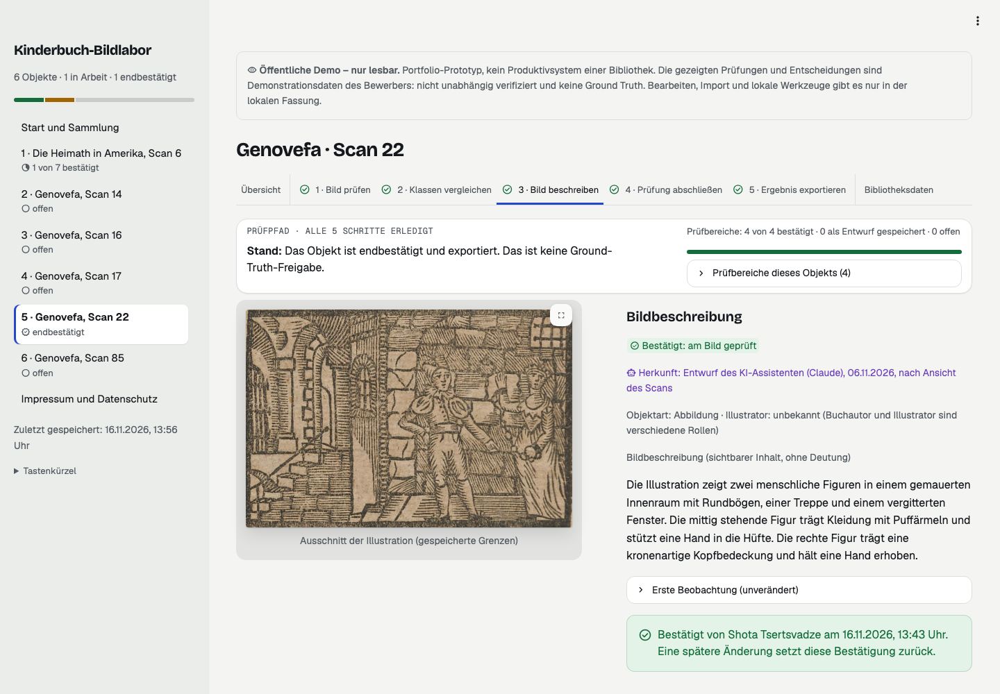
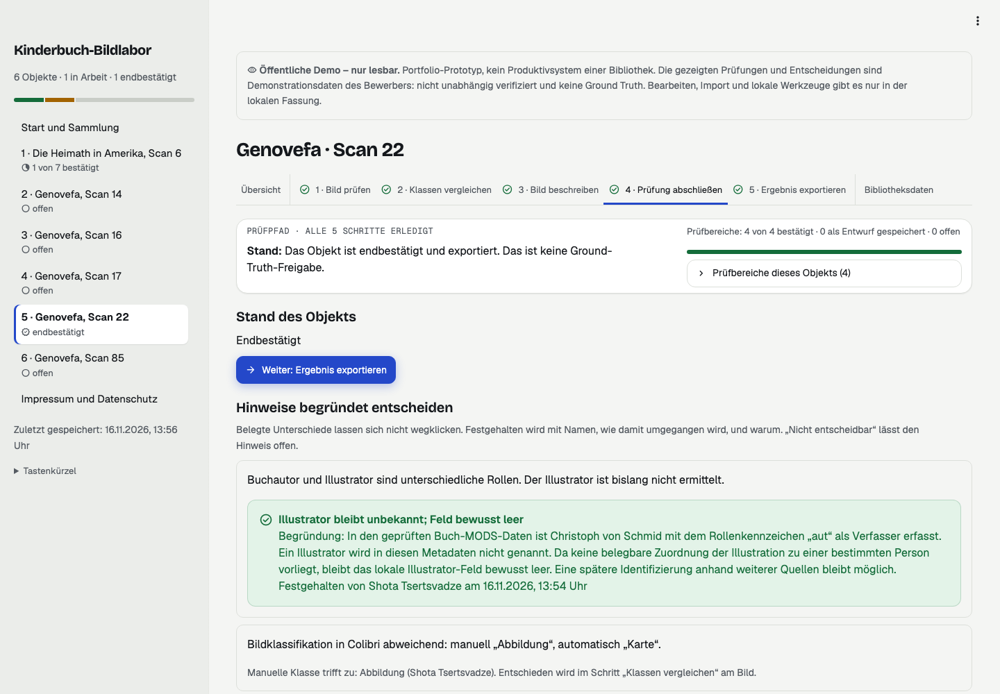
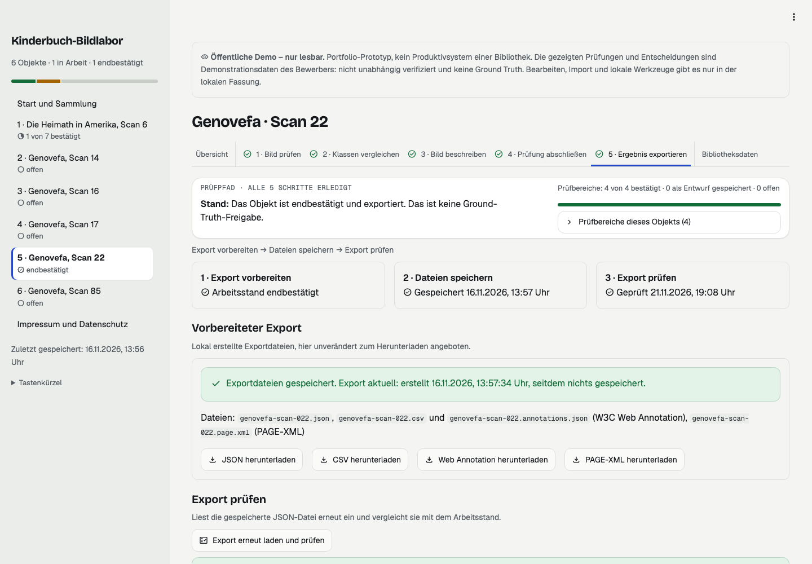
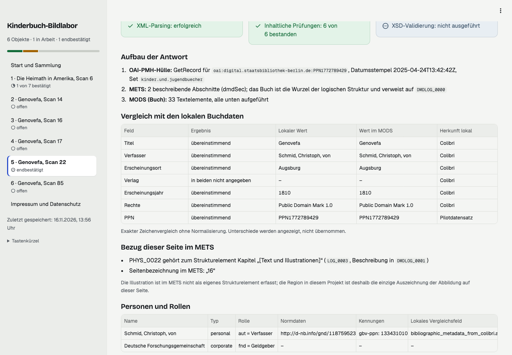

# Rundgang durch die öffentliche Demo (etwa fünf Minuten)

Die öffentliche Demo ist nur lesbar und braucht keine Anmeldung. Sie zeigt eine echte, von mir
selbst am Bild durchgeführte Prüfung (Genovefa, Augsburg 1810, Scan 22) und fünf weitere Beispiele im
unbearbeiteten Quellstand. Alle Bestätigungen sind Demonstrationsprüfungen einer Person: nicht
unabhängig verifiziert und keine Ground Truth.

## 1. Startseite: die Fragestellung

Colibri, der Bilddatensatz der Staatsbibliothek zu Berlin, führt für diese Illustration zwei Klassen:
manuell „Abbildung“, automatisch „Karte“. Die Demo zeigt, wie die Abweichung am Originalbild geprüft,
begründet entschieden und mit Herkunft exportiert wird. „Leitbeispiel öffnen: Genovefa, Scan 22“.

## 2. Klassen vergleichen

Links die markierte Region und die Belege am Original, rechts beide Colibri-Klassen und die
Entscheidung mit wörtlicher Begründung, Name und Zeitpunkt. Beide Ausgangswerte bleiben erhalten.

## 3. Bild beschreiben

Beschreibung und Suchbegriffe tragen ihre Herkunft (Entwurf eines KI-Assistenten) und getrennte
Bestätigungen. Die Suchbegriffe sind projektlokal, keine geprüften GND-Verknüpfungen.

## 4. Prüfung abschließen

Der Hinweis zum unbekannten Illustrator wird nicht ausgeblendet, sondern begründet entschieden: Das
Buch-MODS nennt nur den Verfasser (Rolle „aut“). Die Endbestätigung ist ausdrücklich keine
Ground-Truth-Freigabe.

## 5. Ergebnis exportieren und prüfen

Der Export liegt als JSON, CSV, W3C Web Annotation und PAGE-XML vor. „Export erneut laden und
prüfen“ liest die JSON-Datei zurück und vergleicht sie mit dem Arbeitsstand. Alle vier
Dateien und ein Prüfbericht (HTML) lassen sich herunterladen.

## 6. Bibliotheksdaten

Die gespeicherte OAI-PMH-Antwort (METS/MODS) wird ausgewertet: Buch-MODS über die logische
METS-Wurzel, exakter Zeichenvergleich mit den lokalen Angaben, Seitenbezug im METS, Personen und
Rollen mit GND-Verweis. Keine Live-Abfrage, keine XSD-Validierung.

## Was die Demo nicht zeigt

Bearbeiten, Import, lokale OCR, Modellvorschläge und GND-Suche gibt es nur in der lokalen Fassung.
Nicht vorhanden sind vollständiges OAI-Harvesting, MODS- oder ALTO-Export, XSD-validierte
Standardkonformität und eine OCR-Qualitätsmessung gegen eine Referenz.
