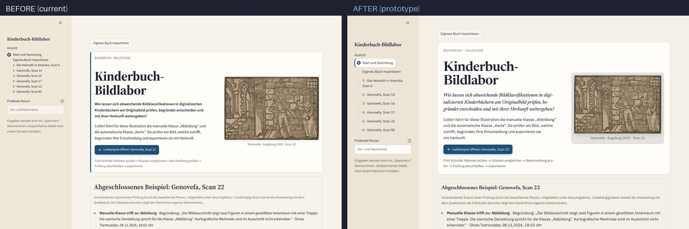
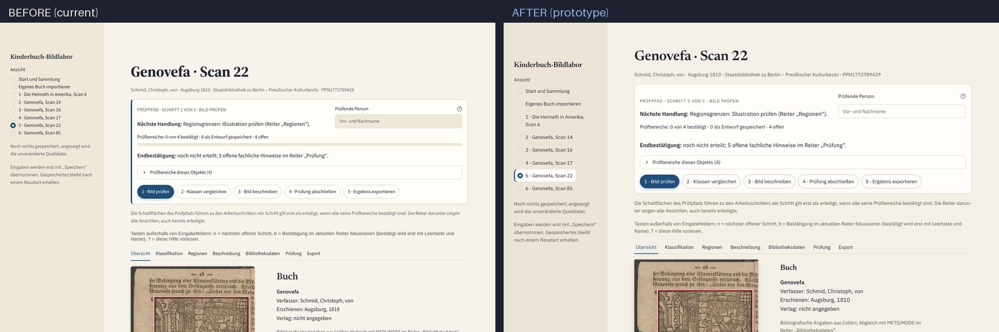
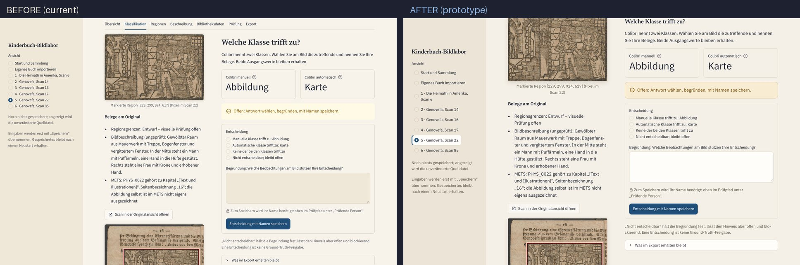
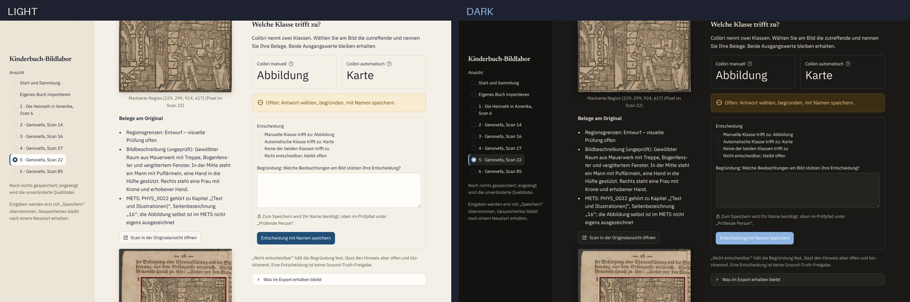

# Design System: Lesesaal 2

Design specification for the Kinderbuch-Bildlabor user interface. It refines the existing "Lesesaal"
(reading room) concept rather than replacing it: paper-toned ground, ink-dark text, Berlin blue
reserved for the next action. The UI language stays German; this document is written in English
for the implementing agent.

- **Implementation prompts:** [GG_CODER_PROMPTS.md](GG_CODER_PROMPTS.md)
- **Validated reference files:** [reference/](reference/) (`config.toml`, `workflow.css`, `theme.py`)
- **Before/after previews:** [preview/](preview/)

Phase 1 of this system (tokens, fonts, light and dark themes, base CSS) was prototyped against
Streamlit 1.67.0 in an isolated copy of the app. All 191 tests passed unchanged, `ruff check`
passed, and fonts loaded from local files with no network access.



---

## 1. Who uses this and what they do

Reviewers at a library or archive check historical children's-book illustrations against the
saved scan and the catalogue metadata. They confirm region frames, decide between conflicting
classifications, check descriptions and transcriptions, give a named final approval, and export
the result with provenance. Sessions are long, the work needs care, and every decision is signed
with a name. The interface has to support **careful, repeated looking at old images** and make
**review state readable at a glance**.

## 2. Design principles

1. **The scan is the subject.** The image gets the most space and a neutral surround. No UI chrome
   competes with it, and it is never cropped by layout.
2. **One next action.** In any area of the screen there is at most one primary (Berlin blue) button,
   and it is the step the Prüfpfad recommends. Everything else is secondary or tertiary.
3. **State is always readable.** Every review state is shown as icon + word + color, never color
   alone, and the same state looks the same everywhere (sidebar, Prüfpfad, tab content, cards).
4. **Provenance is visible.** Machine-made content (Colibri automatic class, OCR, AI draft) is marked
   with one consistent "maschinell" style, distinct from human decisions.
5. **Calm density.** Explanations are available but not shouting: one-line captions, longer
   rationale in expanders or `help=` tooltips. Visual noise is reduced before content is removed.
6. **Offline and accessible by default.** No runtime CDN. WCAG 2.2 AA contrast, keyboard operable,
   reduced motion respected, German page language for screen readers.

## 3. What works today and what to improve

| Area | Today | Change |
|---|---|---|
| Concept | Coherent "Lesesaal" idea, serif headings, accessible focus ring, reduced motion | Keep the concept; formalize it as tokens |
| Typography | Streamlit defaults (Source Sans/Serif); keyboard hint renders in Arial | Bundled Newsreader + IBM Plex Sans + IBM Plex Mono; every text uses the theme fonts |
| Language | `<html lang="en">` on a German UI: screen readers mispronounce, no hyphenation | Set `lang="de"`; enable `hyphens: auto` for long German compounds |
| Inputs | Beige fields on beige page read as disabled; border contrast about 1.3:1 | Near-white fields with a 3.4:1+ border (WCAG 1.4.11) |
| Captions | Muted with `opacity: 0.7` (also fades icons and links) | Fixed muted ink color, 6:1 or better |
| Status colors | Streamlit default yellow/blue/orange; "Offen" shown in orange, so a fresh object looks alarming | Harmonized semantic palette; untouched = neutral gray, amber only for saved-but-unconfirmed |
| Scan display | Warm paper surround biases how sepia scans look | Neutral gray mat ("Passepartout") behind every scan |
| Region overlays | Same region is red on overview tabs (colored by number) and blue in the editor (colored by type) | One color per region type everywhere, color-blind-safe (Okabe-Ito) |
| Object page | Header, Prüfpfad card, two explanatory captions and keyboard hint push the scan below the fold at 1440×900 | Compact Prüfpfad; explanations folded in; work area starts higher |
| Navigation | Three navigation systems (sidebar radio, step pills, tabs) with no shared state display | Sidebar shows per-object status; steps and tabs share the same state vocabulary |
| Accent bars | 4px left border on cards (a common template look) | Plain bordered surfaces with soft elevation |
| Dark mode | None | "Nachtlesesaal" dark theme follows the OS setting |

## 4. Color

### 4.1 Core tokens

All text/background pairs below were checked against WCAG 2.2 (ratios in brackets).

| Token | Role | Light | Dark |
|---|---|---|---|
| `canvas` | App background (Streamlit `backgroundColor`) | `#F5F0E7` | `#1A1917` |
| `surface` | Cards, inputs, expanders (Streamlit `secondaryBackgroundColor`) | `#FFFDF9` | `#24231F` |
| `sunken` | Sidebar, table header, inline code | `#ECE5D7` | `#2E2C27` |
| `border` | Decorative borders, dividers | `#DED4C3` | `#3D3A33` |
| `border-strong` | Secondary button outlines | `#C4B79F` | `#57534A` |
| `control` | Input field borders (needs 3:1) | `#8C8170` (3.4–3.8:1) | `#857D6E` (3.9–4.3:1) |
| `ink` | Body text | `#1D2130` (14.1:1) | `#ECE6DA` (14.1:1) |
| `ink-muted` | Captions, labels, metadata | `#5A5446` (6.0–7.4:1) | `#B4AC9C` (6.2–7.8:1) |
| `ink-subtle` | Placeholders only | `#776F60` (4.4–4.9:1) | `#978F80` (4.9–5.5:1) |
| `primary` | Berliner Blau: next action, focus, links | `#1F4E79` (7.6:1; white label 8.7:1) | `#8DB4E2` (8.2:1; label `#10233A` 7.4:1) |
| `mat` | Neutral surround behind scans | `#E3E2DF` | `#121211` |

### 4.2 Semantic status colors

One vocabulary for every review state. These map onto Streamlit's named colors in
`config.toml`, so `st.success`, `st.warning`, `st.error`, `st.info` and `st.badge(color=…)` pick
them up without code changes.

| State (UI wording stays as is) | Meaning | Streamlit color | Icon | Light text / bg | Dark text / bg |
|---|---|---|---|---|---|
| **Offen** (untouched, proposed, provisional) | Nobody has worked on this yet | `gray` | `:material/radio_button_unchecked:` | `#4F493C` / `#ECE6DB` (7.2:1) | `#CFC6B5` / `#2F2D28` |
| **Entwurf / ungespeicherte Änderung** | Saved or typed, not yet confirmed | `yellow` and `orange` (same amber) | `:material/edit_note:` | `#7D4E00` / `#F8ECD3` (6.1:1) | `#F0C778` / `#3A2D14` |
| **Bestätigt** | Named person confirmed this area | `green` | `:material/check_circle:` | `#2B6639` / `#E5EFE4` (5.8:1) | `#9FD3A8` / `#1F3324` |
| **Endbestätigt** | Final approval given (not Ground Truth) | `green` | `:material/verified:` | as Bestätigt | as Bestätigt |
| **Blocker, Konflikt, Fehler** | Must be resolved; blocks approval | `red` | `:material/block:` / `sync_problem` / `error` | `#9B2A1F` / `#F8E3DE` (6.2:1) | `#F2A399` / `#41211C` |
| **Hinweis, nicht ausgeführt** | Neutral system information | `blue` (slate, not Berlin blue) | `:material/info:` | `#2E5470` / `#E5EDF3` (6.8:1) | `#A9C8E2` / `#1D2C38` |
| **Maschinell** (Colibri automatisch, OCR, KI-Entwurf) | Provenance marker | `violet` | `:material/smart_toy:` | `#5E4485` / `#EEE7F5` (6.6:1) | `#C9B5EA` / `#2E2540` |
| **Nächste Handlung** | Call to action | `primary` button | `:material/arrow_forward:` | white on `#1F4E79` | `#10233A` on `#8DB4E2` |

Rules:

- Amber means "you or someone has done work here that still needs a named confirmation". It is not
  used for untouched items. A fresh object should look calm (gray), not alarming.
- Red is reserved for things that block approval or need intervention.
- Berlin blue is never used for status; it only marks the action to take.

### 4.3 Region overlay colors (on scans)

Overlays sit on warm, high-texture woodcuts, so they use the color-blind-safe Okabe-Ito hues plus
the existing white outer halo and dark inner line (keep that technique from `regions.py`).

| Region type | Color | Notes |
|---|---|---|
| Illustration | `#0072B2` (blue) | Default for image regions |
| Text | `#D55E00` (vermilion) | Transcription regions |
| Other / unknown | `#009E73` (bluish green) | Fallback |
| Unsaved new region | Type color, dashed `2u 1.5u` | Dash pattern, not color, signals "not saved" |
| Selected | Type color, stroke ×1.5, white corner handles | |

Color by **type**, not by region number, in both the server-rendered crops (`regions.py`) and the
canvas editor (`region_canvas.js`). The number label stays as the identifier.

## 5. Typography

### 5.1 Families (all SIL Open Font License, bundled locally)

| Role | Family | Why | Files (Fontsource 5.3.x) |
|---|---|---|---|
| Headings, research question, large values | **Newsreader** (variable, optical size) | Bookish serif built for screens; optical sizing keeps display sizes elegant and small sizes sturdy; complete German glyphs, true italics | `newsreader-latin-opsz-normal.woff2`, `…-latin-ext-opsz-normal.woff2`, `…-latin-opsz-italic.woff2` |
| UI and body text | **IBM Plex Sans** (variable) | Institutional, highly legible, distinct `Il1`, good umlauts, tabular figures | `ibm-plex-sans-latin-wght-normal.woff2`, `…-latin-ext-wght-normal.woff2` |
| Identifiers | **IBM Plex Mono** 400/500 | PPN, `DMDLOG_0000`, coordinates `[229, 299, 924, 617]`, checksums, paths | `ibm-plex-mono-latin-400-normal.woff2`, `…-500-normal.woff2` |

Total payload is about 600 KB, served from `static/fonts/` via `server.enableStaticServing`.
Include each package's `LICENSE` file next to the fonts (`static/fonts/OFL-<family>.txt`).

### 5.2 Scale

| Use | Font | Size / line height | Weight |
|---|---|---|---|
| Hero title (start page only) | Newsreader | `clamp(2.25rem, 4.5vw, 3.5rem)` / 1.02, tracking −0.02em | 600 |
| h1 object title | Newsreader | 2.5rem / 1.1 | 600 |
| h2 section | Newsreader | 1.75rem / 1.2 | 600 |
| h3 subsection | Newsreader | 1.375rem / 1.25 | 600 |
| Research question (Leitfrage) | Newsreader italic | 1.3rem / 1.4 | 500 |
| Body | Plex Sans | 1rem (16px) / 1.6 | 400 |
| Label, button | Plex Sans | 0.875–1rem | 500 |
| Caption | Plex Sans | 0.875rem / 1.5, color `ink-muted` | 400 |
| Eyebrow (PRÜFPFAD · SCHRITT 1 VON 5) | Plex Sans | 0.75rem, uppercase, tracking 0.08em | 600 |
| Identifier | Plex Mono | 0.875em | 400 |

### 5.3 German typography rules

- `lang="de"` on `<html>` (Streamlit ships `lang="en"`); `hyphens: auto` on paragraphs and list
  items so compounds such as *Endbestätigung* and *Regionsgrenzen* break cleanly on narrow screens.
- Keep German quotation marks „…“ exactly as written in the copy.
- `font-variant-numeric: tabular-nums` for counters ("0 von 4 bestätigt"), progress text and tables.
- `text-wrap: balance` on headings, `text-wrap: pretty` on paragraphs.
- Line length for running text: aim for 60–80 characters; do not stretch paragraphs across the full
  wide layout.

## 6. Spacing, shape, elevation

- **Spacing scale (rem):** 0.25 · 0.5 · 0.75 · 1 · 1.5 · 2 · 3 · 4. Use 1.5rem between related
  blocks, 3rem between page sections.
- **Radius:** controls and buttons 0.5rem; cards and expanders 0.625–0.875rem; step chips 999px;
  scan images 0.25rem (paper has nearly square corners).
- **Elevation:** `shadow-1` = `0 1px 2px rgba(29,33,48,.06)` for cards; scans use
  `shadow-scan` (two-layer soft lift). No other shadows. Prefer borders over shadows.
- **Touch targets:** at least 40px high on desktop, 44px on phones.

## 7. Layout and information architecture

### 7.1 App shell

```
┌ Sidebar (sunken) ─────────┐ ┌ Main (canvas) ─────────────────────────────────────────────┐
│ Kinderbuch-Bildlabor       │ │ eyebrow · H1 · metadata line                                │
│                            │ │ ┌ Prüfpfad (surface card) ─────────────────────────────────┐ │
│ ÜBERSICHT                  │ │ │ PRÜFPFAD · SCHRITT 1 VON 5          Prüfende Person [___] │ │
│   Start und Sammlung       │ │ │ Nächste Handlung: …                                       │ │
│   Eigenes Buch importieren │ │ │ (1 Bild prüfen)(2 Klassen)(3 Beschreibung)(4 …)(5 Export) │ │
│ OBJEKTE                    │ │ │ ▓▓▓░░░░░ 0 von 4 bestätigt · 0 Entwurf · 4 offen  ⌄ Details│ │
│   ○ 1 · Heimath, Scan 6    │ │ └───────────────────────────────────────────────────────────┘ │
│   ◐ 2 · Genovefa, Scan 14  │ │ Übersicht | Klassifikation | Regionen | … | Prüfung | Export│
│ ▌ ✓ 5 · Genovefa, Scan 22  │ │ ┌ Scan stage (mat, sticky) ─┐ ┌ Work panel ───────────────┐ │
│                            │ │ │                            │ │ H2 question               │ │
│ Eingaben werden erst mit … │ │ │        [ scan ]            │ │ evidence · form · sign-off │ │
└────────────────────────────┘ │ └────────────────────────────┘ └───────────────────────────┘ │
                               └─────────────────────────────────────────────────────────────┘
```

- **Sidebar:** brand wordmark in Newsreader; navigation as a list (not visible radio circles);
  active item on `surface` with a 3px inset Berlin-blue edge; each object shows its review state
  icon (○ offen, ◐ in Arbeit, ✓ endbestätigt). Group headers "Übersicht" and "Objekte".
- **Object header:** eyebrow with book and place/year, H1 "Genovefa · Scan 22", metadata line with
  PPN in mono. An object status chip may sit to the right of the title.
- **Prüfpfad:** one compact card. The two captions that currently sit below it (step explanation
  and keyboard hint) move inside the card, into its footer or the "Prüfbereiche dieses Objekts"
  expander. Goal at 1440×900: the tab bar and the top of the scan are visible without scrolling.
- **Work area:** two columns, scan left (2) and controls right (3), as today (`ui.SPLIT`). The scan
  column stays sticky on wide screens.

### 7.2 Start page order

Keep the demo narrative but bring the collection closer to the top:

1. Hero: eyebrow, title, research question (serif italic), short intro, primary "Leitbeispiel
   öffnen", and "Eigenes Buch importieren" as a secondary button next to it (move it out of the
   floating position above the hero).
2. Stichprobe grid: the six objects as cards with status chip, progress and Colibri classes
   (manual as neutral chip, automatic as violet "maschinell" chip).
3. Fallstudie table.
4. Abgeschlossenes Beispiel.
5. Zweites Beispiel.
6. Begriffe kurz erklärt.
7. Werkzeuge: CSV export and Sicherung side by side.

## 8. Components

| Component | Spec |
|---|---|
| **Primary button** | Berlin blue fill, white label, radius 0.5rem, optional leading arrow icon. One per area. Keep the existing two-bounce "next step" animation; disabled by `prefers-reduced-motion`. |
| **Secondary button** | Transparent or `surface`, 1px `border-strong`, ink label. |
| **Tertiary / link** | "Scan in der Originalansicht öffnen": link style with external-link icon. |
| **Step chip (Prüfpfad)** | Pill, 40px high. Current = primary fill. Done = secondary with green `check_circle` icon. Upcoming = outlined. Keep the `help=` text. |
| **Status badge** | `st.badge` with the semantic color and icon from 4.2. Wording unchanged. |
| **Sign-off panel** (`ui.confirm_controls`, key `…-review-box`) | Reads as a signature block: `surface`, 1px `border-strong`, radius 0.75rem, title "Prüfung mit Ihrem Namen bestätigen", statement checkbox, primary confirm button, lock icon + reason in `ink-muted` when disabled. After confirmation the green `st.success` note replaces the visual weight. |
| **Decision options** (classification and Hinweise radios) | Each option as a full-width row: 44px min height, 1px border, radius 0.5rem; hover border `primary`; selected = `primary` border + light primary tint. Scope with a keyed container so the sidebar radio is not affected. |
| **Comparison cards** ("Colibri manuell" vs "Colibri automatisch") | Two equal cards; value in Newsreader 2rem; automatic card carries a violet "maschinell" badge. |
| **Scan stage** | `mat` background, 0.75rem padding, radius 0.75rem; image radius 0.25rem with `shadow-scan`; caption below in `ink-muted`, coordinates in mono. |
| **Alerts** | Theme colors from 4.2 plus a 1px border at 22% of the text color, radius 0.625rem. Avoid stacking more than one alert per area. |
| **Tabs** | Weight 500, active 600 with primary underline. Optional: sticky tab bar under the header (adjust the sticky scan offset if you do this). |
| **Tables** | Header on `sunken`, tabular numbers, 1px `border`. |
| **Expander** | `surface` background, `border`, radius 0.625rem. |
| **Keyboard hint** (`review_keys.py`) | Inherit the theme font; 0.875rem; color `var(--bl-ink-muted)`. Optional: render keys as `<kbd>` chips. |
| **Focus** | 3px `primary` outline, 2px offset, on every interactive element (keep existing rule). |

## 9. Motion

Only two motions: the existing "next step" nudge (700ms, twice) and hover/focus color transitions
(120ms). Everything is disabled under `prefers-reduced-motion: reduce` (existing rule stays).

## 10. Accessibility checklist

- [ ] Text contrast ≥ 4.5:1, large text ≥ 3:1, input borders and focus ring ≥ 3:1 (values in §4
  already pass in both modes).
- [ ] No state conveyed by color alone (icon + word always present).
- [ ] `lang="de"` set on the document.
- [ ] All actions reachable by keyboard; visible focus ring everywhere; keyboard hint readable.
- [ ] Usable at 200% browser zoom and at 390px width without horizontal scrolling.
- [ ] Images keep their `alt` texts.
- [ ] Reduced motion respected.

## 11. Implementation notes for Streamlit 1.67

- **Configuration first, CSS second.** Colors, fonts, heading sizes, radius and dark mode are native
  `config.toml` options in 1.67 (`[theme.light]`, `[theme.dark]`, `[[theme.fontFaces]]`,
  `headingFontSizes`, `greenBackgroundColor`, …). Use [reference/config.toml](reference/config.toml)
  as is.
- **Tokens for custom CSS** come from `theme.inject()` ([reference/theme.py](reference/theme.py)),
  which writes `--bl-*` CSS variables for the active mode using `st.context.theme.type`.
  `workflow.css` uses only these variables, never raw hex values.
- **Selectors:** prefer the `.st-key-<key>` classes Streamlit adds to keyed containers. If you need
  a new hook, wrap the element in `st.container(key="…")`. Use `data-testid` selectors sparingly,
  never `:nth-child`, and never `:first-child` on generic elements (in the prototype a
  `:first-child` caption rule leaked onto unrelated captions).
- **Do not change** widget keys, tab labels, session-state keys, German copy, or the element type of
  any text (`st.caption`, `st.markdown`, `st.info`, `st.success`, `st.warning`, `st.error`,
  `st.subheader`, `st.title`). The tests assert exact texts per element type. Restyle through the
  theme instead.
- **Offline:** no Google Fonts or CDN URLs. Fonts live in `static/fonts/`.
- **Fonts download** (one time, needs internet; or copy from `npm pack`):
  `https://cdn.jsdelivr.net/npm/@fontsource-variable/newsreader@5.3.0/files/<file>`,
  `https://cdn.jsdelivr.net/npm/@fontsource-variable/ibm-plex-sans@5.3.0/files/<file>`,
  `https://cdn.jsdelivr.net/npm/@fontsource/ibm-plex-mono@5.3.0/files/<file>`;
  license files at `…/<package>@5.3.0/LICENSE`.
- **Verify visually** only with an isolated data directory:
  `BILDLABOR_DATA_DIR=$(mktemp -d) uv run streamlit run app.py`.
  Opening the app can migrate and write working copies.

## 12. Previews

| | |
|---|---|
| Object page and Prüfpfad |  |
| Classification decision |  |
| Light and dark |  |

The previews show Phase 1 only (tokens, fonts, base CSS). Phases 2–5 in the prompt file add the
structural improvements (compact Prüfpfad, sidebar status, decision option cards, overlay colors,
start page order).
