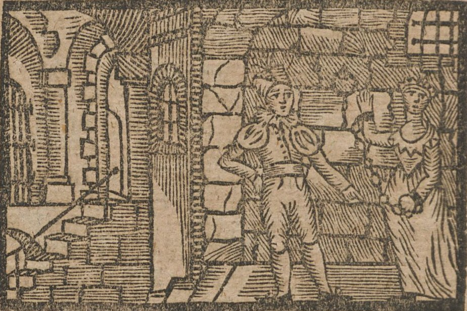

# Geprüftes Beispiel: Genovefa, Scan 22

Diese Seite zeigt ohne Installation, was die bewerbende Person an einer Illustration selbst geprüft und
entschieden hat. Grundlage ist ihr unveränderter Export aus der Anwendung.

Drei Stände sind zu unterscheiden:

| Stand | Wo | Inhalt |
|---|---|---|
| Geprüftes Beispiel | diese Seite, Dateien in diesem Ordner | Genovefa, Scan 22: von Shota Tsertsvadze geprüft, entschieden und endbestätigt |
| Weitere Beispiele | in der Anwendung, Liste in [OFFENE_PUNKTE.md](../OFFENE_PUNKTE.md) | Genovefa, Scans 14, 16, 17 und 85 ungeprüft; „Die Heimath in Amerika“ nur der Titelrahmen bestätigt (Pilotexport unten) |
| Frischer Arbeitsstand der App | eigener Datenordner nach dem Start | alle sechs Objekte im Quellstand, alle Prüfbereiche offen, bis jemand selbst prüft |

## Auf einen Blick

Ausschnitt aus Scan 22 von „Genovefa“ (Augsburg 1810, PPN1772789429), Region 229, 299, 924, 617
(x, y, Breite, Höhe in Pixeln des Scans). Quelle: Staatsbibliothek zu Berlin – Preußischer Kulturbesitz,
[Originalansicht](https://digital.staatsbibliothek-berlin.de/werkansicht?PPN=PPN1772789429&PHYSID=PHYS_0022), Public Domain Mark 1.0.

**Ausgangsklassen im Colibri-Datensatz**

| Colibri-Spalte | Klasse |
|---|---|
| manuell (`groundtruth`) | Abbildung |
| automatisch (`classification`) | Karte |

**Entscheidung zur Klassifikation** (Shota Tsertsvadze, wörtlich aus dem Export)

> Manuelle Klasse trifft zu: Abbildung
>
> Begründung: „Der Bildausschnitt zeigt zwei Figuren in einem gewölbten Innenraum mit einer Treppe. Die szenische Darstellung spricht für die Klasse „Abbildung“. Kartografische Merkmale sind im Ausschnitt nicht erkennbar.“

**Entscheidung zum Illustrator** (Shota Tsertsvadze, wörtlich aus dem Export)

> Illustrator bleibt unbekannt; Feld bewusst leer
>
> Begründung: „Im geprüften Bildausschnitt konnte ich keine eindeutige Angabe zum Illustrator erkennen. Die Zuschreibung bleibt offen; das Feld bleibt daher leer. Weitere Quellen wurden von mir nicht geprüft.“

Endbestätigung: Shota Tsertsvadze, 08.11.2026, 19:11 Uhr. Sie ist keine
Ground-Truth-Freigabe; eine Zweitprüfung durch eine andere Person gab es nicht.

**Dateien**

| Datei | Inhalt | SHA-256 |
|---|---|---|
| [genovefa-scan-022.json](genovefa-scan-022.json) | vollständiger Arbeitsstand mit Entscheidungen, Prüfprotokoll und Änderungsgeschichte | `388cc6d2ead4410df9c3d7209610ea80eeecac733b5f223fdbef2b13158106e6` |
| [genovefa-scan-022.csv](genovefa-scan-022.csv) | eine Zeile je Region mit beiden Colibri-Klassen, Entscheidung, Herkunft und Rechten | `f54441509f82c62b7863b47450a289456ec04d1ceb1c1bfc8f7afb74473cc39b` |
| [pilot-001.json](pilot-001.json) | Pilotobjekt „Die Heimath in Amerika“, Scan 6 | `febad0e61af20420cf85ffc58110dd325d6f2b4f2de167848fcac64595e955fd` |
| [pilot-001.csv](pilot-001.csv) | dasselbe als CSV | `9ed2e6abad8beb95d094b90dca3545a0567b04f090b82ea8576ada05082bcd8a` |

JSON und CSV sind unveränderte Exporte. Der Bildausschnitt wurde für diese Seite aus dem mitgelieferten
Quellscan `sammlung/genovefa/scan_022_page.jpg` erzeugt und gehört nicht zum Export.

## Einzelheiten zu Genovefa, Scan 22

Geprüft im Arbeitsordner der bewerbenden Person, exportiert am 08.11.2026 um 19:11:25 Uhr. Der
Export entspricht dem gespeicherten Arbeitsstand; seitdem wurde nichts gespeichert. Die
Rückladeprüfung der Anwendung, rein lesend auf Export und Arbeitsstand angewendet, ergibt 6 von 6
Prüfpunkten erhalten. Beide geltenden Entscheidungen und die Endbestätigung tragen den Namen
„Shota Tsertsvadze“.

Das Prüfprotokoll ist vollständig erhalten, auch mit früheren Namensangaben. Zeiten in Berliner
Ortszeit:

| Zeit | Name im Protokoll | Vorgang |
|---|---|---|
| 13:50–13:52 | shota | Regionsgrenzen, Bildbeschreibung und Suchbegriffe bestätigt; Klassifikation und Illustrator mit der Begründung „Entscheidung trifft zu“ entschieden; Endbestätigung |
| 14:18–14:19 | ShotaTest | beide Entscheidungen mit den heute geltenden Begründungen neu festgehalten; Endbestätigung |
| 19:02–19:11 | Shota Tsertsvadze | beide Entscheidungen unverändert erneut bestätigt (Illustrator zweimal); Endbestätigung zuletzt um 19:11 Uhr |

Jede neue oder erneut bestätigte Entscheidung hat die vorige Endbestätigung aufgehoben. Auch diese
Aufhebungen stehen im Protokoll.

Das Beispiel zeigt, wie eine Entscheidung weitergegeben wird:
- Beide Colibri-Werte bleiben unverändert erhalten (manuell „Abbildung“, automatisch „Karte“).
- Die Entscheidung steht daneben, mit Name, Zeitpunkt und den Regionsgrenzen, auf denen sie beruht.
- Herkunft (automatisch ermittelte Grenzen, KI-Entwürfe) und Prüfstand sind getrennt ausgewiesen.
- Die Änderungsgeschichte gehört zum Export und wird beim Zurücklesen verglichen.

## Einschränkungen

- Die Endbestätigung ist keine Ground-Truth-Freigabe. Es gab keine Zweitprüfung durch eine andere
  Person.
- Zum Illustrator wurden nach eigener Angabe nur der Bildausschnitt, keine weiteren Quellen geprüft.
- Die Bestätigungen von Rahmen, Beschreibung und Suchbegriffe tragen im Protokoll den Namen „shota“.
  Sie wurden nicht erneut bestätigt.
- Geprüft ist nur Scan 22. Die Scans 14, 16, 17 und 85 sind offen (siehe [OFFENE_PUNKTE.md](../OFFENE_PUNKTE.md)).
- Im JSON stehen die Herkunftsfelder in ihrem überlieferten Wortlaut, einschließlich „ungeprüft“. Der
  Prüfstand steht in den eigenen Statusfeldern; die CSV zeigt beides getrennt.
- Das frühere Beispiel (Export vom 08.11.2026, 12:27 Uhr, aus einem anderen Arbeitsordner) ist durch
  diesen Export ersetzt. Es bleibt in der Git-Geschichte (Commit `c13a701`) erhalten.

## Pilotobjekt „Die Heimath in Amerika“

Der Pilotexport (07.11.2026, 23:05 Uhr) stammt aus dem vorigen Übergabe-ZIP und wurde unverändert
übernommen. Sein Inhalt stimmt mit dem lokalen Arbeitsstand des Pilotobjekts überein. Er belegt eine
einzelne Bestätigung: den Rahmen um den Bildtitel, von Shota Tsertsvadze am 06.11.2026 um 15:50 Uhr. Die
übrigen Regionen, die Beschreibung und beide Transkriptionen sind offen. Die Suchbegriffe tragen den
Status „vom Nutzer akzeptiert“ aus dem Startpaket, ohne Protokolleintrag mit Name und Zeitpunkt.
